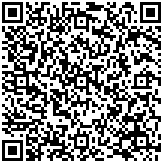
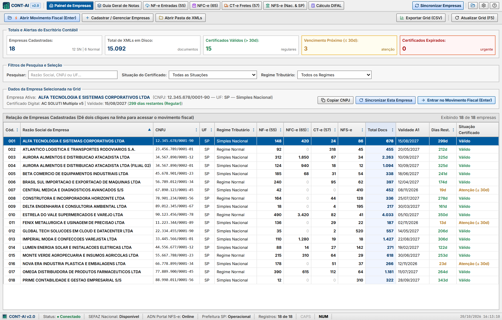
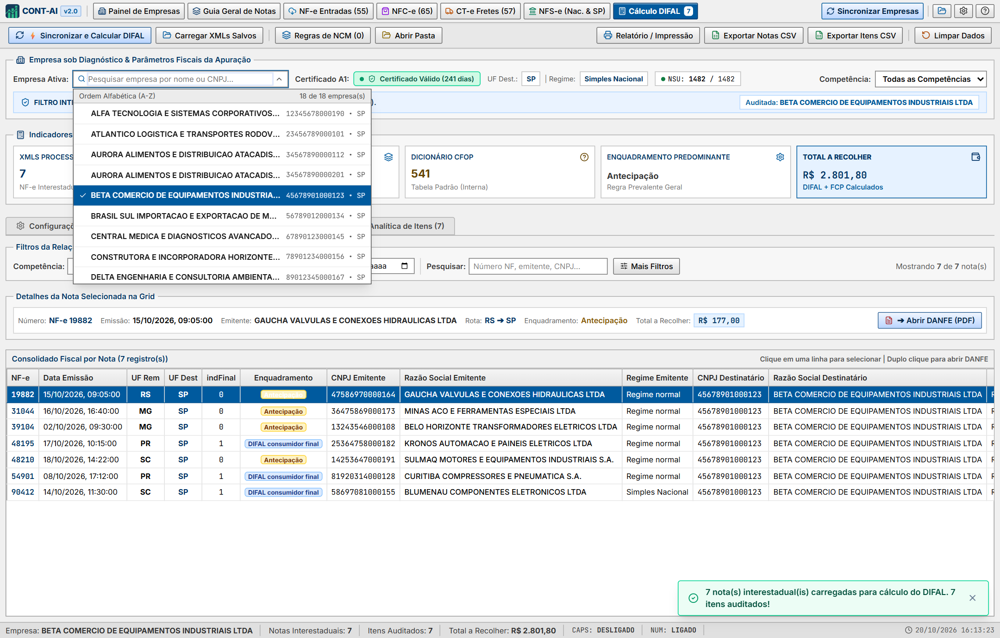
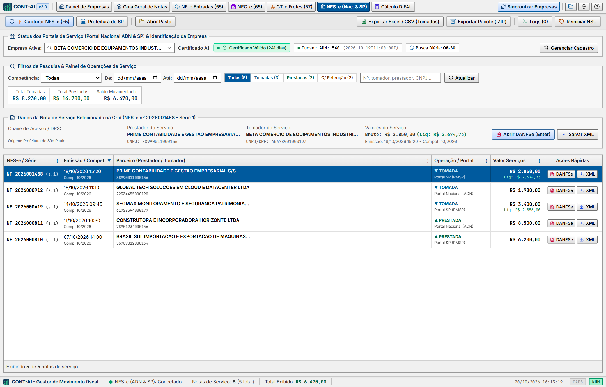
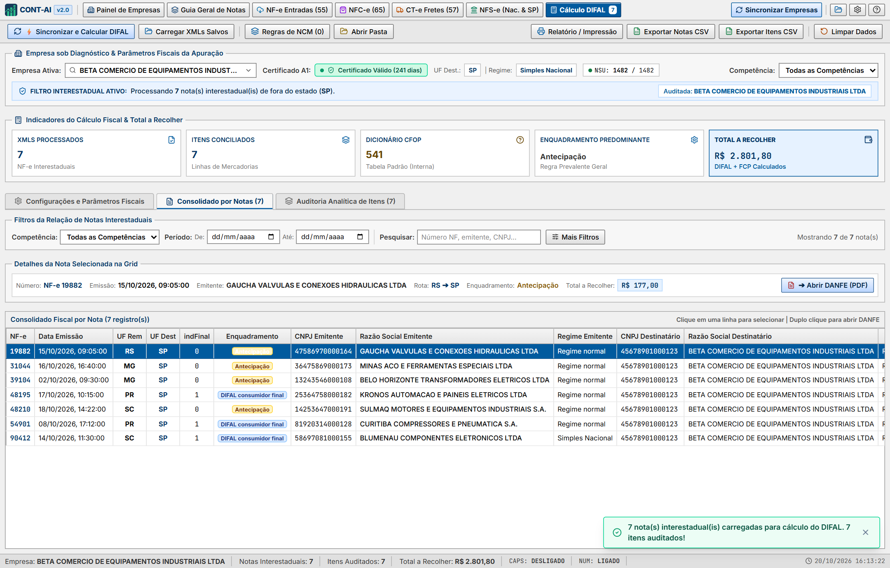
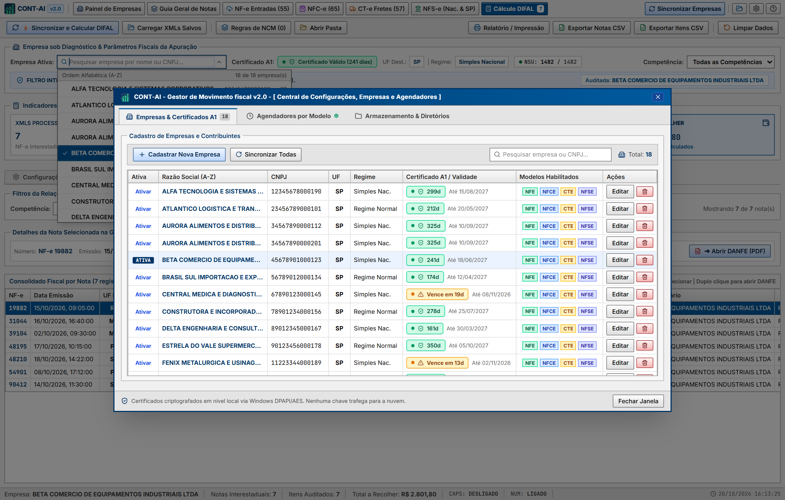

<div align="center">
  
  <h1>CONT-AI v2.0 — Gestor de Movimento Fiscal & Apuração de DIFAL</h1>
  <p>
    <strong>Sistema Desktop ERP para Captação Automatizada de Documentos Fiscais Eletrônicos (NF-e, NFC-e, CT-e e NFS-e) via Certificado Digital A1 (mTLS) e Auditoria/Apuração de DIFAL e Antecipação Tributária.</strong>
  </p>
  <p>
    
    
    
    
    
  </p>
</div>

---

## 📥 Download Direto do Instalador Windows (`.exe`)

Para instalar o **CONT-AI v2.0** diretamente no seu computador (Windows 10 / 11 x64) sem precisar compilar o código-fonte, clique no link abaixo:

👉 **[🌐 Acessar Site Oficial de Download & Demonstração (GitHub Pages)](https://rammeta.github.io/cont-ai/)**  
👉 **[⬇️ Baixar Instalador Oficial — CONT-AI-Setup-2.0.0.exe (Windows x64)](https://github.com/Rammeta/cont-ai/releases/download/v2.0.0/CONT-AI-Setup-2.0.0.exe)**  
*(Ou acesse a página de [Releases Oficiais do Repositório](https://github.com/Rammeta/cont-ai/releases/latest))*

---

## ☕ Apoie o Projeto (PIX)

O **CONT-AI** é distribuído de forma aberta e gratuita para ajudar escritórios de contabilidade, analistas fiscais e empresas a automatizarem a captação de documentos fiscais, emissão de NFS-e Nacional e auditoria de DIFAL.

Se esta ferramenta economiza horas do seu trabalho mensal e você deseja apoiar a manutenção e evolução do projeto, faça uma contribuição voluntária de qualquer valor via **PIX**:

<table>
  <tr>
    <td align="center" width="240">
      
      <br />
      <sub><b>Escaneie com o app do seu banco</b></sub>
    </td>
    <td valign="middle">
      <p><b>🏢 Recebedor:</b> <code>66.604.571 VAGNER GODOY D</code> <i>(Conta PJ — São Paulo/SP)</i></p>
      <p><b>🔑 Chave PIX (CNPJ):</b> <code>66.604.571/0001-43</code></p>
      <p><b>🔑 Chave PIX Aleatória (EVP):</b> <code>ad834588-7fb9-45e7-8f01-7f7de3db757b</code></p>
      <p><b>📋 PIX Copia e Cola</b> <i>(clique no ícone de copiar no canto do bloco abaixo)</i>:</p>
    </td>
  </tr>
</table>

```text
00020126580014BR.GOV.BCB.PIX0136ad834588-7fb9-45e7-8f01-7f7de3db757b5204000053039865802BR592566.604.571 VAGNER GODOY D6009SAO PAULO61080540900062250521SJooPzypjS6LVYq7wbe1a6304EAE0
```

---

## Sumário

1. [Download Direto do Instalador Windows (`.exe`)](#-download-direto-do-instalador-windows-exe)
2. [Apoie o Projeto (PIX)](#-apoie-o-projeto-pix)
3. [Sobre o Projeto](#-sobre-o-projeto)
4. [Todas as Funcionalidades Discriminadas (com Prints)](#-todas-as-funcionalidades-discriminadas-com-prints)
   - [1. Painel de Empresas (Hub Multi-CNPJ)](#1-painel-de-empresas-hub-multi-cnpj)
   - [2. Busca e Seleção Rápida de Empresas em Ordem Alfabética (A-Z)](#2-busca-e-seleção-rápida-de-empresas-em-ordem-alfabética-a-z)
   - [3. Guia Geral de Notas (Consolidação Fiscal dos 4 Modelos)](#3-guia-geral-de-notas-consolidação-fiscal-dos-4-modelos)
   - [4. NF-e Entradas (Modelo 55 — SEFAZ Nacional)](#4-nf-e-entradas-modelo-55--sefaz-nacional)
   - [5. NFC-e (Modelo 65 — Cupons Fiscais Eletrônicos)](#5-nfc-e-modelo-65--cupons-fiscais-eletrônicos)
   - [6. CT-e Fretes (Modelo 57 — Transporte de Cargas)](#6-ct-e-fretes-modelo-57--transporte-de-cargas)
   - [7. NFS-e (Portal Nacional ADN & Prefeitura de São Paulo)](#7-nfs-e-portal-nacional-adn--prefeitura-de-são-paulo)
   - [8. Cálculo e Auditoria de DIFAL / Antecipação Tributária](#8-cálculo-e-auditoria-de-difal--antecipação-tributária)
   - [9. Central de Configurações, Empresas, Agendadores e Repositório](#9-central-de-configurações-empresas-agendadores-e-repositório)
5. [Tutorial Passo a Passo de Uso no Dia a Dia](#-tutorial-passo-a-passo-de-uso-no-dia-a-dia)
6. [Tutorial de Instalação (Ambiente de Desenvolvimento)](#-tutorial-de-instalação-ambiente-de-desenvolvimento)
7. [Tutorial para Gerar o Executável / Instalador Windows (`.exe`)](#-tutorial-para-gerar-o-executável--instalador-windows-exe)
8. [Arquitetura e Segurança](#-arquitetura-e-segurança)

---

## 📌 Sobre o Projeto

O **CONT-AI v2.0** foi projetado para resolver os principais gargalos operacionais de escritórios de contabilidade e departamentos fiscais:
- **Captação descentralizada de XMLs:** Elimina a necessidade de acessar múltiplos portais estaduais e municipais manualmente, conectando-se diretamente via **Certificado Digital A1 (`.pfx` / `.p12`)** aos WebServices oficiais da **SEFAZ Nacional**, **Ambiente de Dados Nacional (ADN)** e **Prefeitura de São Paulo**.
- **Controle de Certificados Digitais:** Monitora a validade de dezenas de certificados simultaneamente com alertas visuais de vencimento (`≤ 30 dias` e expirados).
- **Apuração de DIFAL e Antecipação Tributária:** Audita automaticamente todas as notas fiscais interestaduais de entrada, consulta o enquadramento tributário dos fornecedores (Simples Nacional vs. Regime Normal) e gera a memória de cálculo completa por nota e por item/NCM.

---

## 🖥️ Todas as Funcionalidades Discriminadas (com Prints)

### 1. Painel de Empresas (Hub Multi-CNPJ)
Tela inicial de comando para gestão da carteira de clientes do escritório contábil:
- **Indicadores Executivos (KPIs):** Total de empresas cadastradas (separadas entre Simples Nacional e Regime Normal), total de XMLs armazenados em disco, certificados regulares (`> 30d`), certificados com vencimento próximo (`≤ 30d`) e certificados expirados.
- **Grid Consolidada de Movimento Fiscal:** Exibe em tempo real a contagem de documentos capturados por empresa em cada modelo (**NF-e 55**, **NFC-e 65**, **CT-e 57**, **NFS-e** e **Total de Documentos**), destacando visualmente as empresas com movimento no período.
- **Sincronização Individual ou em Lote:** Permite sincronizar uma empresa específica ou disparar a sincronização geral de todas as empresas cadastradas com um clique.
- **Exportação Cadastral:** Exporta a relação completa de empresas, status de certificados e volumetria em planilha CSV/Excel.



---

### 2. Busca e Seleção Rápida de Empresas em Ordem Alfabética (A-Z)
Presente em todos os módulos operacionais do sistema:
- **Ordenação Automática (A-Z):** Independentemente da ordem em que as empresas foram cadastradas, a listagem é exibida sempre em ordem alfabética pela Razão Social.
- **Filtro Instantâneo (Combobox):** Ao clicar no seletor da **Empresa Ativa**, o campo permite digitar qualquer trecho da **Razão Social**, **CNPJ** (com ou sem pontuação) ou **UF**, filtrando os resultados em tempo real com suporte completo a navegação pelo teclado (`↑`, `↓`, `Enter` e `Esc`).



---

### 3. Guia Geral de Notas (Consolidação Fiscal dos 4 Modelos)
Painel unificado para conferência de fechamento fiscal mensal por empresa:
- **Unificação de Modelos:** Reúne em uma única grade todos os documentos de **NF-e (55)**, **NFC-e (65)**, **CT-e (57)** e **NFS-e**, separando automaticamente **Entradas (Compras/Tomados)** e **Saídas (Vendas/Prestados)**.
- **Totalizadores Financeiros:** Calcula instantaneamente o valor total de entradas, valor total de saídas, quantidade de documentos autorizados e cancelados na competência selecionada (`MM/AAAA`).
- **Ações Rápidas por Documento:** Visualização imediata do documento auxiliar (**DANFE / DACTE / DANFSE**), cópia da chave de acesso de 44 dígitos e exportação de relatório consolidado para Excel (CSV).


---

### 4. NF-e Entradas (Modelo 55 — SEFAZ Nacional)
Módulo dedicado à captação e auditoria de Notas Fiscais Eletrônicas de Entrada:
- **Integração Nativa `NFeDistribuicaoDFe`:** Consulta sequencial por NSU (`ultNSU` / `maxNSU`) diretamente no Ambiente Nacional da SEFAZ.
- **Manifestação Automática do Destinatário (`210210`):** Registra automaticamente o evento de *Ciência da Operação* sobre os resumos (`resNFe`) encontrados para liberar o download do XML completo (`procNFe`).
- **Busca Direta por Chave de Acesso:** Permite consultar e baixar notas específicas informando a chave de 44 dígitos.
- **Classificação Automática de Rota:** Identifica se cada nota é **Interna (Mesma UF)** ou **Interestadual (Fora da UF — Candidata ao DIFAL)**.
- **Consulta Automática ao Simples Nacional:** Verifica via CNPJ dos fornecedores emitentes quais são optantes pelo Simples Nacional e quais pertencem ao Regime Normal (RPA).
- **Geração de DANFE PDF e Pacotes ZIP:** Emissão instantânea de DANFE em PDF e exportação em lote dos XMLs do mês em arquivo `.ZIP`.


---

### 5. NFC-e (Modelo 65 — Cupons Fiscais Eletrônicos)
Módulo voltado à gestão e captação de Notas Fiscais de Consumidor Eletrônicas:
- **Consulta por Período e Competência:** Captação estruturada com controle de taxa de requisição (*Rate Limiter*) para evitar bloqueios na SEFAZ estadual.
- **Importação e Organização Automática em Disco:** Leitura de XMLs de NFC-e com separação automática por CNPJ e competência (`AAAA-MM`), identificando documentos autorizados e cancelados.
- **Relatórios Analíticos:** Exportação de planilha completa de cupons fiscais em CSV e pacote compactado de XMLs.


---

### 6. CT-e Fretes (Modelo 57 — Transporte de Cargas)
Módulo para controle de Conhecimentos de Transporte Eletrônicos:
- **Integração `CTeDistribuicaoDFe`:** Captura automática de CT-es emitidos contra o CNPJ da empresa na condição de **Tomador do Serviço**, **Remetente**, **Destinatário** ou **Expedidor/Recebedor**.
- **Auditoria de Frete e ICMS de Transporte:** Exibe remetente, destinatário, transportadora emitente, CFOP, rota (`UF Origem → UF Destino`), valor do frete e status do documento.
- **Geração Nativa de DACTE (PDF):** Renderiza o Documento Auxiliar do CT-e diretamente a partir do XML armazenado.


---

### 7. NFS-e (Portal Nacional ADN & Prefeitura de São Paulo)
Módulo híbrido para captação de Notas Fiscais de Serviços Eletrônicas:
- **Dupla Integração Automática:**
  1. **Portal Nacional de NFS-e (ADN / Sefin Nacional):** Consulta via API REST mTLS por NSU para municípios integrados ao padrão nacional.
  2. **Prefeitura Municipal de São Paulo (Paulistana):** Integração SOAP mTLS (`PedidoConsultaNFePeriodo`) capturando tanto **Serviços Tomados (Entradas)** quanto **Serviços Prestados (Saídas)**.
- **Auditoria de Retenções Federais e ISS:** Detalha Valor dos Serviços, Base de Cálculo, Alíquota, Valor do ISS, ISS Retido, PIS, COFINS, INSS, IRRF e CSLL.
- **Emissão de DANFSE em PDF:** Gera o espelho completo da Nota Fiscal de Serviço com brasão e layout padronizado para impressão ou envio ao cliente.



---

### 8. Cálculo e Auditoria de DIFAL / Antecipação Tributária
Motor especializado de auditoria fiscal para compras interestaduais:
- **Filtro Automático de Operações Interestaduais:** Descarta automaticamente notas internas (`UF Origem === UF Destino`) e modelos não sujeitos ao cálculo na entrada, mantendo apenas as NF-es interestaduais (`UF Origem ≠ UF Destino`).
- **Parametrização Fiscal Completa:**
  - Alíquota Interna do Estado de Destino (ex: `18%`) e Fundo de Combate à Pobreza (`FCP %`).
  - Regras específicas por **NCM** (alíquotas internas diferenciadas de `12%`, `7%`, `25%`, etc.).
  - Modo de cálculo **Base Dupla ("Por Dentro")** ou **Base Simples ("Por Fora")**.
  - Inclusão ou exclusão do **IPI** na base de cálculo conforme a destinação da mercadoria (**Uso/Consumo/Ativo Imobilizado** vs. **Revenda/Industrialização**).
- **Memória de Cálculo Analítica:** Apresenta a fórmula exata aplicada em cada item da nota fiscal, permitindo alternar individualmente a destinação de qualquer mercadoria e exportar relatórios em **PDF para Impressão**, **CSV Consolidado por Nota** e **CSV Analítico por Item**.



---

### 9. Central de Configurações, Empresas, Agendadores e Repositório
Painel administrativo acessível pelo ícone de engrenagem no cabeçalho:
- **Aba 1 — Empresas & Certificados A1:** Cadastro de empresas por leitura automática do arquivo `.pfx`/`.p12` (extrai Razão Social, CNPJ e validade automaticamente do certificado), busca em diretório de rede e ativação individual de quais modelos (`NFE`, `NFCE`, `CTE`, `NFSE`) cada empresa deve sincronizar.
- **Aba 2 — Agendadores por Modelo:** Configuração de horários diários de busca automática em segundo plano (bandeja do sistema / *System Tray*).
- **Aba 3 — Armazenamento & Diretórios:** Definição da pasta raiz onde os XMLs são salvos e organizados automaticamente por empresa/ano-mês, além de ferramentas de manutenção de cache e reinicialização de NSU.



---

## 📋 Tutorial Passo a Passo de Uso no Dia a Dia

1. **Cadastrar uma Empresa e Certificado A1:**
   - Clique no ícone **⚙ (Configurações)** no canto superior direito ou no botão **`+ Cadastrar / Gerenciar Empresas`** no Painel de Empresas.
   - Clique em **`+ Cadastrar Nova Empresa`**, selecione o arquivo `.pfx` ou `.p12` do cliente e digite a senha do certificado.
   - O sistema lerá automaticamente o **CNPJ**, **Razão Social** e **Data de Validade** do certificado. Defina o Regime Tributário (`Simples Nacional` ou `Regime Normal`) e salve.
2. **Sincronizar os Documentos Fiscais:**
   - Para buscar notas de todas as empresas de uma só vez, clique em **`🔄 Sincronizar Empresas`** no topo direito da tela.
   - Para buscar notas de apenas uma empresa específica, selecione-a no campo **`Empresa Ativa`** (pesquisando por nome ou CNPJ em ordem alfabética) e clique no botão azul de sincronização do módulo desejado (**NF-e**, **NFC-e**, **CT-e** ou **NFS-e**).
3. **Auditar e Calcular o DIFAL:**
   - Na aba **NF-e Entradas (55)**, após sincronizar as notas do mês, clique no botão **`Enviar p/ Auditoria DIFAL`** (ou acesse diretamente a aba **Cálculo DIFAL** e clique em **`⚡ Sincronizar e Calcular DIFAL`**).
   - Confira os itens nas abas **Consolidado por Notas** e **Auditoria Analítica de Itens**, ajuste regras de NCM se necessário e clique em **`🖨️ Relatório / Impressão`** ou **`📊 Exportar Notas CSV`**.

---

## 💻 Tutorial de Instalação (Ambiente de Desenvolvimento)

### Pré-requisitos
- **[Node.js](https://nodejs.org/)** (versão 18 LTS ou superior)
- **[Git](https://git-scm.com/)** instalado

### Passo a Passo

```bash
# 1. Clone o repositório
git clone https://github.com/Rammeta/cont-ai.git

# 2. Acesse a pasta do projeto
cd cont-ai

# 3. Instale todas as dependências do projeto
npm install

# 4. (Opcional) Inicie o servidor de desenvolvimento da interface React (Vite)
npm run dev
```

---

## 📦 Tutorial para Gerar o Executável / Instalador Windows (`.exe`)

Para compilar o código-fonte em produção e gerar o instalador completo do Windows (`CONT-AI - Gestor de Movimento Fiscal Setup 1.0.0.exe`):

### Passo 1: Instalar dependências de empacotamento (caso ainda não estejam instaladas)
```bash
npm install --save-dev electron electron-builder
```

### Passo 2: Executar o comando de Build
```bash
npm run electron:build
```
O comando acima executará duas etapas automaticamente:
1. **`vite build`**: Compila e otimiza todo o frontend React/TypeScript na pasta `dist/`.
2. **`electron-builder -w`**: Empacota o backend Node.js/Electron (`main.cjs`, `sefaz/`, `nfse/`) junto com a interface compilada e gera o instalador NSIS para Windows.

### Passo 3: Localizar o Instalador Gerado
Ao finalizar o processo, os arquivos estarão disponíveis na pasta `dist_electron/`:
- **`dist_electron/CONT-AI - Gestor de Movimento Fiscal Setup 1.0.0.exe`**: Instalador oficial com assistente de instalação e criação de atalho na Área de Trabalho e Menu Iniciar.
- **`dist_electron/win-unpacked/CONT-AI - Gestor de Movimento Fiscal.exe`**: Versão portátil (executável direto sem necessidade de instalação).

---

## 🔒 Arquitetura e Segurança

```
cont-ai/
├── assets/                  # Ícones e logotipos do aplicativo
├── docs/screenshots/        # Capturas de tela da documentação
├── nfse/                    # Motores de integração NFS-e (ADN Nacional REST & Prefeitura SP SOAP)
├── sefaz/                   # Motores de integração SEFAZ (NFeDistribuicaoDFe, CTe, Manifestação, DANFE/DACTE)
├── src/
│   ├── components/          # Telas dos módulos e componentes visuais (React + Tailwind)
│   ├── data/                # Dicionário interno de CFOPs
│   ├── utils/               # Motor matemático de cálculo de DIFAL/Antecipação e ponte IPC
│   ├── App.tsx              # Gerenciamento de estado global e roteamento de módulos
│   └── types.ts             # Tipagens TypeScript
├── main.cjs                 # Processo principal do Electron (IPC Handlers, Agendador e System Tray)
├── package.json             # Dependências e configuração do Electron Builder
└── vite.config.ts           # Configuração de bundler Vite
```

- **Privacidade Total (Zero-Cloud Storage):** Os certificados digitais A1 e XMLs fiscais permanecem exclusivamente no computador local do usuário, utilizando conexões diretas **TLS 1.2 / mTLS** com os servidores governamentais da Receita Federal / SEFAZ e Prefeituras.

---

## 👨‍💻 Autor & Contato

Idealizado e desenvolvido por **Vagner Godoy de Melo** — *Analista Fiscal Jr. | Análise de Dados | Automações*:
- **Formação:** Bacharel em Ciências Contábeis (Universidade Cruzeiro do Sul) e Técnico em Informática (ETEC Machado de Assis).
- **Vivência Prática:** Atuação direta na rotina fiscal, contábil e de operações integradas de escritórios contábeis, unindo a vivência dos gargalos tributários reais com o desenvolvimento de automações.
- **LinkedIn:** [linkedin.com/in/vagnergmelo](https://www.linkedin.com/in/vagnergmelo/)
- **GitHub:** [github.com/Rammeta/cont-ai](https://github.com/Rammeta/cont-ai)
- **Site Oficial:** [rammeta.github.io/cont-ai](https://rammeta.github.io/cont-ai/)

---

## ⚖️ Licença de Uso (Código Aberto Não-Comercial)

Copyright (c) 2026 **Vagner Godoy de Melo** — **CONT-AI Gestor de Movimento Fiscal**

Este software é disponibilizado sob a **[Licença de Código Aberto Não-Comercial (Source-Available Non-Commercial License)](LICENSE)**:
- **Permitido:** Uso gratuito pelo usuário final, visualização do código para estudo, auditoria de segurança e avaliação técnica individual.
- **Estritamente Proibido:** Copiar, redistribuir, sublicenciar, vender, alugar, hospedar como serviço (SaaS), embutir em softwares comerciais de terceiros ou remover os créditos e marcas originais deste software sem autorização prévia, expressa e por escrito do autor.

