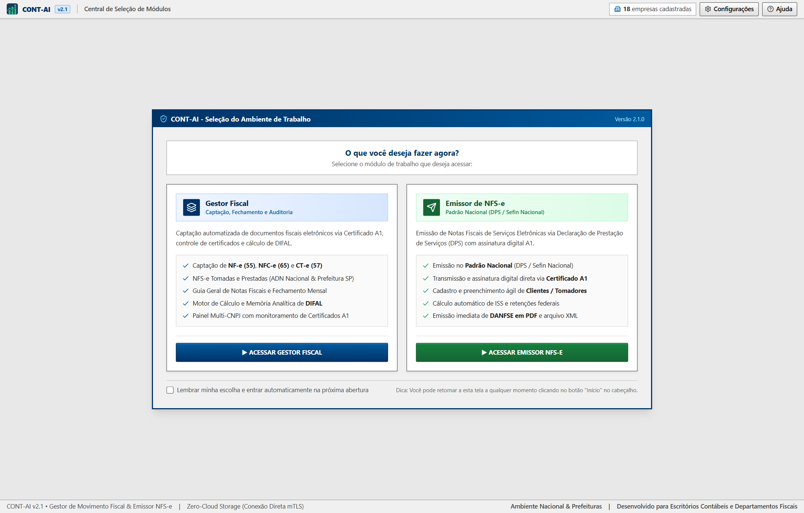
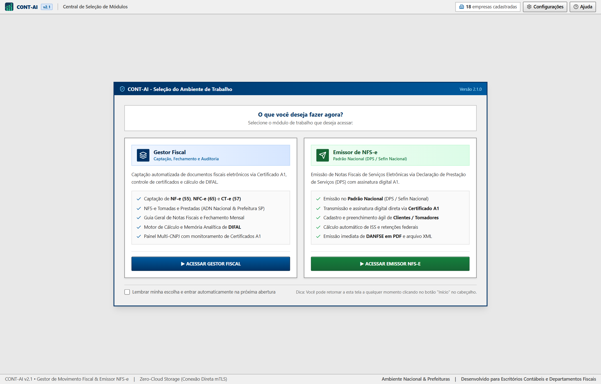
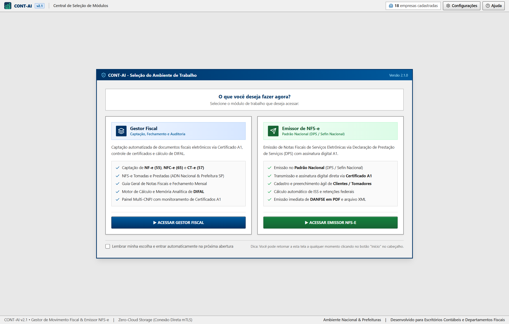
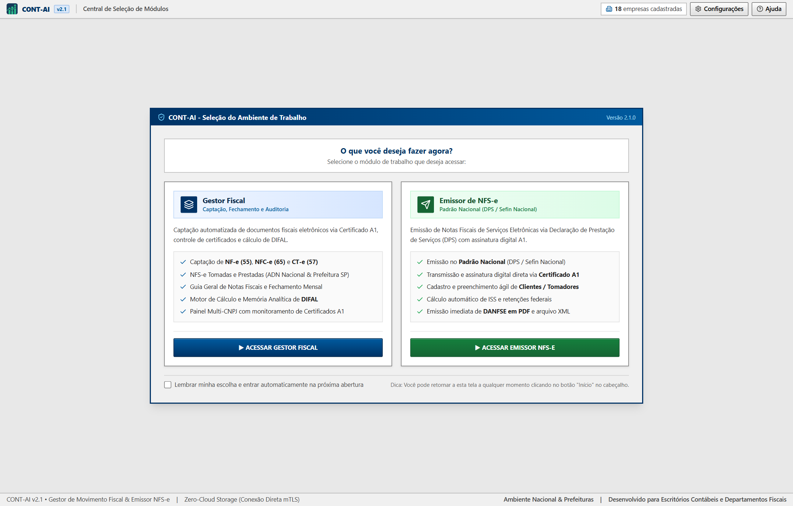
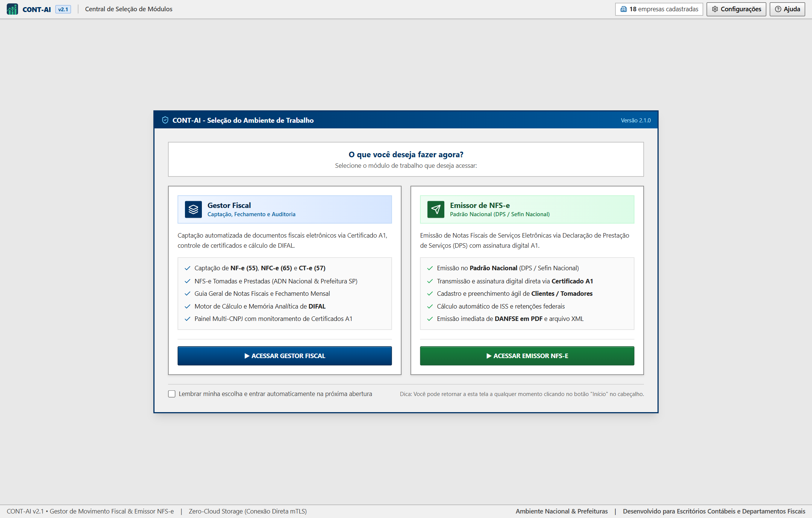

<div align="center">
  
  <h1>CONT-AI v2.1 — Gestor de Movimento Fiscal & Emissor de NFS-e Nacional</h1>
  <p>
    <strong>Sistema Desktop ERP para Captação Automatizada de Documentos Fiscais Eletrônicos (NF-e, NFC-e, CT-e e NFS-e), Emissão de NFS-e Nacional (DPS / Sefin / ADN) via Certificado Digital A1 (mTLS) com Emissão Retroativa, Catálogo Oficial dos 335 Serviços (6 Dígitos - LC 116), Correlação NBS/NT 004 e Auditoria de DIFAL.</strong>
  </p>
  <p>
    
    
    
    
    
  </p>
</div>

---

## 📥 Download Direto do Instalador Windows (`.exe`)

Para instalar o **CONT-AI v2.1** diretamente no seu computador (Windows 10 / 11 x64) sem precisar compilar o código-fonte, clique no link abaixo:

👉 **[🌐 Acessar Site Oficial de Download & Demonstração (GitHub Pages)](https://rammeta.github.io/cont-ai/)**  
👉 **[⬇️ Baixar Instalador Oficial — CONT-AI-Setup-2.1.0.exe (Windows x64)](https://github.com/Rammeta/cont-ai/releases/download/v2.1.0/CONT-AI-Setup-2.1.0.exe)**  
*(Ou acesse a página de [Releases Oficiais do Repositório](https://github.com/Rammeta/cont-ai/releases/latest))*

---

## ☕ Apoie o Projeto (PIX)

O **CONT-AI** é distribuído de forma aberta e gratuita para ajudar escritórios de contabilidade, analistas fiscais e empresas a automatizarem a captação de documentos fiscais e auditoria de DIFAL.

Se esta ferramenta economiza horas do seu trabalho mensal e você deseja apoiar a manutenção e evolução do projeto, faça uma contribuição voluntária de qualquer valor via **PIX**:

<table>
  <tr>
    <td align="center" width="240">
      
      <br />
      <sub><b>Escaneie com o app do seu banco</b></sub>
    </td>
    <td valign="middle">
      <p><b>🏢 Recebedor:</b> <code>66.604.571 VAGNER GODOY D</code> <i>(Conta PJ — São Paulo/SP)</i></p>
      <p><b>🔑 Chave PIX (CNPJ):</b> <code>66.604.571/0001-43</code></p>
      <p><b>🔑 Chave PIX Aleatória (EVP):</b> <code>ad834588-7fb9-45e7-8f01-7f7de3db757b</code></p>
      <p><b>📋 PIX Copia e Cola</b> <i>(clique no ícone de copiar no canto do bloco abaixo)</i>:</p>
    </td>
  </tr>
</table>

```text
00020126580014BR.GOV.BCB.PIX0136ad834588-7fb9-45e7-8f01-7f7de3db757b5204000053039865802BR592566.604.571 VAGNER GODOY D6009SAO PAULO61080540900062250521SJooPzypjS6LVYq7wbe1a6304EAE0
```

---

## Sumário

1. [Download Direto do Instalador Windows (`.exe`)](#-download-direto-do-instalador-windows-exe)
2. [Apoie o Projeto (PIX)](#-apoie-o-projeto-pix)
3. [Sobre o Projeto](#-sobre-o-projeto)
4. [Todas as Funcionalidades Discriminadas (com 17 Prints Reais)](#-todas-as-funcionalidades-discriminadas-com-17-prints-reais)
   - [1. Portal de Entrada (Launcher ERP)](#1-portal-de-entrada-launcher-erp)
   - [2. Painel Hub de Empresas (Multi-CNPJ)](#2-painel-hub-de-empresas-multi-cnpj)
   - [3. Busca e Seleção Rápida de Empresas em Ordem Alfabética (A-Z)](#3-busca-e-seleção-rápida-de-empresas-em-ordem-alfabética-a-z)
   - [4. Emissor NFS-e Nacional (Padrão ADN / SEFIN & Emissão Retroativa)](#4-emissor-nfs-e-nacional-padrão-adn--sefin--emissão-retroativa)
   - [5. Catálogo Oficial dos 335 Serviços do Portal Nacional (6 Dígitos - LC 116)](#5-catálogo-oficial-dos-335-serviços-do-portal-nacional-6-dígitos---lc-116)
   - [6. Correlação Atividades x NBS (9 Dígitos) x Reforma Tributária (NT 004)](#6-correlação-atividades-x-nbs-9-dígitos-x-reforma-tributária-nt-004)
   - [7. Gerenciador Master-Detail de Padrões de Emissão](#7-gerenciador-master-detail-de-padrões-de-emissão)
   - [8. Pré-visualização Oficial da DPS / Espelho DANFSE com Código de Barras](#8-pré-visualização-oficial-da-dps--espelho-danfse-com-código-de-barras)
   - [9. Histórico de Notas Emitidas & Cancelamento ADN](#9-histórico-de-notas-emitidas--cancelamento-adn)
   - [10. Meus Clientes (Tomadores Frequentes)](#10-meus-clientes-tomadores-frequentes)
   - [11. Guia Geral de Notas (Consolidação Fiscal dos 4 Modelos)](#11-guia-geral-de-notas-consolidação-fiscal-dos-4-modelos)
   - [12. NF-e Entradas (Modelo 55 — SEFAZ Nacional & Ciência 210210)](#12-nf-e-entradas-modelo-55--sefaz-nacional--ciência-210210)
   - [13. NFC-e (Modelo 65 — Cupons Fiscais Eletrônicos)](#13-nfc-e-modelo-65--cupons-fiscais-eletrônicos)
   - [14. CT-e Fretes (Modelo 57 — Transporte de Cargas)](#14-ct-e-fretes-modelo-57--transporte-de-cargas)
   - [15. NFS-e Consulta (Portal Nacional ADN & Prefeitura Paulistana SP)](#15-nfs-e-consulta-portal-nacional-adn--prefeitura-paulistana-sp)
   - [16. Cálculo e Auditoria de DIFAL / Antecipação Tributária por Item](#16-cálculo-e-auditoria-de-difal--antecipação-tributária-por-item)
   - [17. Central de Configurações, Empresas e Agendadores](#17-central-de-configurações-empresas-e-agendadores)
5. [Mapeamento Exaustivo de Botões, Atalhos e Funções do CONT-AI v2.1](#-mapeamento-exaustivo-de-botões-atalhos-e-funções-do-cont-ai-v21)
6. [Tutorial Passo a Passo de Uso no Dia a Dia](#-tutorial-passo-a-passo-de-uso-no-dia-a-dia)
7. [Tutorial de Instalação (Ambiente de Desenvolvimento)](#-tutorial-de-instalação-ambiente-de-desenvolvimento)
8. [Tutorial para Gerar o Executável / Instalador Windows (`.exe`)](#-tutorial-para-gerar-o-executável--instalador-windows-exe)
9. [Arquitetura e Segurança](#-arquitetura-e-segurança)
10. [Autor & Contato](#-autor--contato)
11. [Licença de Uso](#️-licença-de-uso-código-aberto-não-comercial)

---

## 📌 Sobre o Projeto

O **CONT-AI v2.1** foi projetado para resolver os principais gargalos operacionais de escritórios de contabilidade e departamentos fiscais:
- **Emissor de NFS-e Nacional (ADN / SEFIN):** Emissão completa de Declaração de Prestação de Serviços (DPS) transmitida diretamente aos servidores da Receita Federal / Sefin Nacional via mTLS (Certificado A1 em arquivo `.pfx` ou Windows Store), com suporte a emissões normais e **retroativas**, retenções federais (IRRF, PIS, COFINS, CSLL, INSS), pré-visualização oficial do DANFSE e gestão de clientes frequentes.
- **Catálogo Oficial dos 335 Serviços (LC 116):** Banco completo com os 335 códigos numéricos oficiais de 6 dígitos (`cTribNac`) da Lei Complementar 116/2003, organizados pelos 41 grupos de atividades com busca instantânea.
- **Correlação NBS (9 Dígitos) & Reforma Tributária (NT 004):** Mapeamento direto com Nomenclatura Brasileira de Serviços e preenchimento automático das tags de transição `cIndOp` e `cClassTrib` (IBS e CBS).
- **Captação descentralizada de XMLs:** Elimina a necessidade de acessar múltiplos portais estaduais e municipais manualmente, conectando-se diretamente via **Certificado Digital A1 (`.pfx` / `.p12`)** aos WebServices oficiais da **SEFAZ Nacional**, **Ambiente de Dados Nacional (ADN)** e **Prefeitura de São Paulo**.
- **Controle de Certificados Digitais:** Monitora a validade de dezenas de certificados simultaneamente com alertas visuais de vencimento (`≤ 30 dias` e expirados).
- **Apuração de DIFAL e Antecipação Tributária:** Audita automaticamente todas as notas fiscais interestaduais de entrada, consulta o enquadramento tributário dos fornecedores (Simples Nacional vs. Regime Normal) e gera a memória de cálculo completa por nota e por item/NCM, suportando Base Dupla ("Por Dentro") e Base Simples ("Por Fora").

---

## 🖥️ Todas as Funcionalidades Discriminadas (com 17 Prints Reais)

### 1. Portal de Entrada (Launcher ERP)
Central inicial de navegação corporativa que permite ao usuário escolher diretamente o fluxo de trabalho desejado:
- **Gestor de Movimento Fiscal:** Acesso completo aos módulos de captação de documentos, conciliação e auditoria de DIFAL.
- **Emissor NFS-e Nacional:** Acesso direto ao ambiente de faturamento e emissão oficial de notas de serviços no Padrão Nacional.
- **Identificação Visual Corporativa:** Layout clássico de sistemas de gestão fiscal sem poluição visual.


---

### 2. Painel Hub de Empresas (Multi-CNPJ)
Tela inicial de comando para gestão da carteira de clientes do escritório contábil:
- **Indicadores Executivos (KPIs):** Total de empresas cadastradas (separadas entre Simples Nacional e Regime Normal), total de XMLs armazenados em disco, certificados regulares (`> 30d`), certificados com vencimento próximo (`≤ 30d`) e certificados expirados.
- **Grid Consolidada de Movimento Fiscal:** Exibe em tempo real a contagem de documentos capturados por empresa em cada modelo (**NF-e 55**, **NFC-e 65**, **CT-e 57**, **NFS-e** e **Total de Documentos**), destacando visualmente as empresas com movimento no período.
- **Sincronização Individual ou em Lote:** Permite sincronizar uma empresa específica ou disparar a sincronização geral de todas as empresas cadastradas com um clique.
- **Exportação Cadastral:** Exporta a relação completa de empresas, status de certificados e volumetria em planilha CSV/Excel.


---

### 3. Busca e Seleção Rápida de Empresas em Ordem Alfabética (A-Z)
Presente em todos os módulos operacionais do sistema:
- **Ordenação Automática (A-Z):** Independentemente da ordem em que as empresas foram cadastradas, a listagem é exibida sempre em ordem alfabética pela Razão Social.
- **Filtro Instantâneo (Combobox):** Ao clicar no seletor da **Empresa Ativa**, o campo permite digitar qualquer trecho da **Razão Social**, **CNPJ** (com ou sem pontuação) ou **UF**, filtrando os resultados em tempo real com suporte completo a navegação pelo teclado (`↑`, `↓`, `Enter` e `Esc`).


---

### 4. Emissor NFS-e Nacional (Padrão ADN / SEFIN & Emissão Retroativa)
Módulo completo de faturamento e emissão de Notas Fiscais de Serviços Eletrônicas no Padrão Nacional:
- **Transmissão Direta ADN / SEFIN:** Geração e envio do XML de DPS diretamente ao Ambiente de Dados Nacional da NFS-e via mTLS, utilizando o Certificado Digital A1 da empresa (arquivo `.pfx`/`.p12` ou repositório Windows Store).
- **Emissão Retroativa Flexível:** Permite definir livremente a **Data de Emissão (DPS)** e a **Competência Fiscal** da nota fiscal, facilitando a regularização de serviços prestados em competências anteriores ou datas passadas com validação de segurança.
- **Proteção Visual de Layout:** Campo de dados do tomador adaptado com quebra inteligente de linha e truncamento automático para acomodar nomes e razões sociais muito extensas sem desalinhar os blocos do ERP.
- **Cálculo Completo de Retenções Federais:** Apuração automática ou manual de **ISS Retido**, **PIS**, **COFINS**, **INSS**, **IRRF** e **CSLL**, com cálculo líquido imediato a receber.



---

### 5. Catálogo Oficial dos 335 Serviços do Portal Nacional (6 Dígitos - LC 116)
Modal completo contendo 100% dos 335 subitens oficiais da Lei Complementar 116/2003:
- **Filtro por Grupo LC 116:** Navegação filtrada pelos 41 grupos de atividades econômicas (ex: Item 1 - Informática, Item 4 - Saúde, Item 7 - Engenharia, etc.).
- **Busca em Tempo Real:** Filtro instantâneo por código numérico de 6 dígitos ou termos da descrição do serviço.
- **Seleção Direta:** Transfere com 1 clique o código oficial `cTribNac` e o texto descritivo para o formulário de emissão.



---

### 6. Correlação Atividades x NBS (9 Dígitos) x Reforma Tributária (NT 004)
Aba de inteligência tributária para enquadramento na Nomenclatura Brasileira de Serviços e novas obrigações:
- **Cruzamento Atividades x NBS:** Tabela contendo códigos de 9 dígitos de NBS recomendados para cada tipo de serviço.
- **Reforma Tributária (NT 004):** Mapeamento dos códigos de indicador de operação (`cIndOp`) e classificação tributária (`cClassTrib`) de IBS/CBS.
- **Botão Aplicar Correlação:** Preenche automaticamente todos os campos de classificação fiscal na DPS.



---

### 7. Gerenciador Master-Detail de Padrões de Emissão
Módulo para cadastro de modelos pré-configurados de serviços frequentes:
- **Estrutura Master-Detail:** Lista de padrões à esquerda com formulário completo de edição à direita.
- **Configurações Salvas:** Alíquota de ISS, código nacional `cTribNac`, enquadramento do ISSQN e texto padrão de discriminação.
- **Agilidade na Emissão:** Aplicação do padrão com 1 clique na tela principal de emissão da DPS.


---

### 8. Pré-visualização Oficial da DPS / Espelho DANFSE com Código de Barras
Pré-visualização idêntica ao Documento Auxiliar da NFS-e antes da transmissão oficial:
- **Conferência Completa:** Exibe dados do prestador, tomador, discriminação, retenções federais e valores tributários.
- **Código de Barras Simulado:** Representação do padrão oficial DANFSE com botão para imprimir ou salvar em PDF.
- **Transmissão Direta:** Botão para confirmar a validação e transmitir imediatamente a DPS para a SEFIN Nacional.



---

### 9. Histórico de Notas Emitidas & Cancelamento ADN
Controle operacional de todas as notas fiscais emitidas no padrão nacional:
- **Listagem por Competência:** Filtro por mês/ano exibindo número da DPS, número oficial da NFS-e, tomador, valor e status.
- **Ações Imediatas:** Download do XML oficial assinado pela SEFIN, visualização do DANFSE em PDF e cópia da chave de 50 dígitos.
- **Transmissão de Cancelamento:** Transmissão de evento de cancelamento oficial diretamente ao Ambiente de Dados Nacional (ADN) com justificativa.


---

### 10. Meus Clientes (Tomadores Frequentes)
Catálogo exclusivo de tomadores de serviços de cada empresa:
- **Cadastro Simplificado:** Armazena CNPJ/CPF, Razão Social, E-mail do departamento financeiro e Município/UF.
- **Preenchimento Rápido:** Selecionável por combobox no formulário de emissão, eliminando erros de digitação.
- **Ações de Manutenção:** Adicionar novo cliente, editar dados cadastrais ou excluir tomadores inativos.



---

### 11. Guia Geral de Notas (Consolidação Fiscal dos 4 Modelos)
Painel unificado para conferência de fechamento fiscal mensal por empresa:
- **Unificação de Modelos:** Reúne em uma única grade todos os documentos de **NF-e (55)**, **NFC-e (65)**, **CT-e (57)** e **NFS-e**, separando automaticamente **Entradas (Compras/Tomados)** e **Saídas (Vendas/Prestados)**.
- **Totalizadores Financeiros:** Calcula instantaneamente o valor total de entradas, valor total de saídas, quantidade de documentos autorizados e cancelados na competência selecionada (`MM/AAAA`).
- **Ações Rápidas por Documento:** Visualização imediata do documento auxiliar (**DANFE / DACTE / DANFSE**), cópia da chave de acesso de 44 dígitos e exportação de relatório consolidado para Excel (CSV).


---

### 12. NF-e Entradas (Modelo 55 — SEFAZ Nacional & Ciência 210210)
Módulo dedicado à captação e auditoria de Notas Fiscais Eletrônicas de Entrada:
- **Integração Nativa `NFeDistribuicaoDFe`:** Consulta sequencial por NSU (`ultNSU` / `maxNSU`) diretamente no Ambiente Nacional da SEFAZ.
- **Manifestação Automática do Destinatário (`210210`):** Registra automaticamente o evento de *Ciência da Operação* sobre os resumos (`resNFe`) encontrados para liberar o download do XML completo (`procNFe`).
- **Busca Direta por Chave de Acesso:** Permite consultar e baixar notas específicas informando a chave de 44 dígitos.
- **Classificação Automática de Rota:** Identifica se cada nota é **Interna (Mesma UF)** ou **Interestadual (Fora da UF — Candidata ao DIFAL)**.
- **Consulta Automática ao Simples Nacional:** Verifica via CNPJ dos fornecedores emitentes quais são optantes pelo Simples Nacional e quais pertencem ao Regime Normal (RPA).
- **Geração de DANFE PDF e Pacotes ZIP:** Emissão instantânea de DANFE em PDF e exportação em lote dos XMLs do mês em arquivo `.ZIP`.


---

### 13. NFC-e (Modelo 65 — Cupons Fiscais Eletrônicos)
Módulo voltado à gestão e captação de Notas Fiscais de Consumidor Eletrônicas:
- **Consulta por Período e Competência:** Captação estruturada com controle de taxa de requisição (*Rate Limiter*) para evitar bloqueios na SEFAZ estadual.
- **Importação e Organização Automática em Disco:** Leitura de XMLs de NFC-e com separação automática por CNPJ e competência (`AAAA-MM`), identificando documentos autorizados e cancelados.
- **Relatórios Analíticos:** Exportação de planilha completa de cupons fiscais em CSV e pacote compactado de XMLs.


---

### 14. CT-e Fretes (Modelo 57 — Transporte de Cargas)
Módulo para controle de Conhecimentos de Transporte Eletrônicos:
- **Integração `CTeDistribuicaoDFe`:** Captura automática de CT-es emitidos contra o CNPJ da empresa na condição de **Tomador do Serviço**, **Remetente**, **Destinatário** ou **Expedidor/Recebedor**.
- **Auditoria de Frete e ICMS de Transporte:** Exibe remetente, destinatário, transportadora emitente, CFOP, rota (`UF Origem → UF Destino`), valor do frete e status do documento.
- **Geração Nativa de DACTE (PDF):** Renderiza o Documento Auxiliar do CT-e diretamente a partir do XML armazenado.


---

### 15. NFS-e Consulta (Portal Nacional ADN & Prefeitura Paulistana SP)
Módulo híbrido para captação de Notas Fiscais de Serviços Eletrônicas:
- **Dupla Integração Automática:**
  1. **Portal Nacional de NFS-e (ADN / Sefin Nacional):** Consulta via API REST mTLS por NSU para municípios integrados ao padrão nacional.
  2. **Prefeitura Municipal de São Paulo (Paulistana):** Integração SOAP mTLS (`PedidoConsultaNFePeriodo`) capturando tanto **Serviços Tomados (Entradas)** quanto **Serviços Prestados (Saídas)**.
- **Auditoria de Retenções Federais e ISS:** Detalha Valor dos Serviços, Base de Cálculo, Alíquota, Valor do ISS, ISS Retido, PIS, COFINS, INSS, IRRF e CSLL.
- **Emissão de DANFSE em PDF:** Gera o espelho completo da Nota Fiscal de Serviço com brasão e layout padronizado para impressão ou envio ao cliente.


---

### 16. Cálculo e Auditoria de DIFAL / Antecipação Tributária por Item
Motor especializado de auditoria fiscal para compras interestaduais:
- **Filtro Automático de Operações Interestaduais:** Descarta automaticamente notas internas (`UF Origem === UF Destino`) e modelos não sujeitos ao cálculo na entrada, mantendo apenas as NF-es interestaduais (`UF Origem ≠ UF Destino`).
- **Parametrização Fiscal Completa:**
  - Alíquota Interna do Estado de Destino (ex: `18%`) e Fundo de Combate à Pobreza (`FCP %`).
  - Regras específicas por **NCM** (alíquotas internas diferenciadas de `12%`, `7%`, `25%`, etc.).
  - Modo de cálculo **Base Dupla ("Por Dentro")** ou **Base Simples ("Por Fora")**.
  - Inclusão ou exclusão do **IPI** na base de cálculo conforme a destinação da mercadoria (**Uso/Consumo/Ativo Imobilizado** vs. **Revenda/Industrialização**).
- **Memória de Cálculo Analítica:** Apresenta a fórmula exata aplicada em cada item da nota fiscal, permitindo alternar individualmente a destinação de qualquer mercadoria e exportar relatórios em **PDF para Impressão**, **CSV Consolidado por Nota** e **CSV Analítico por Item**.


---

### 17. Central de Configurações, Empresas e Agendadores
Painel administrativo acessível pelo ícone de engrenagem no cabeçalho:
- **Aba 1 — Empresas & Certificados A1:** Cadastro de empresas por leitura automática do arquivo `.pfx`/`.p12` ou repositório Windows Store (extrai Razão Social, CNPJ e validade automaticamente do certificado), busca em diretório de rede e ativação individual de quais modelos (`NFE`, `NFCE`, `CTE`, `NFSE`) cada empresa deve sincronizar.
- **Aba 2 — Agendadores por Modelo:** Configuração de horários diários de busca automática em segundo plano (bandeja do sistema / *System Tray*).
- **Aba 3 — Armazenamento & Diretórios:** Definição da pasta raiz onde os XMLs são salvos e organizados automaticamente por empresa/ano-mês, além de ferramentas de manutenção de cache e reinicialização de NSU.


---

## 🕹️ Mapeamento Exaustivo de Botões, Atalhos e Funções do CONT-AI v2.1

A tabela a seguir apresenta o mapeamento detalhado de **todos os botões, atalhos, modais e controles fiscais** disponíveis na versão 2.1:

| Módulo / Local | Botão ou Controle | Tipo / Atalho | Ação Executada | Efeito Técnico e Regra Fiscal |
| :--- | :--- | :--- | :--- | :--- |
| **Global (Header)** | **Empresa Ativa** | Combobox com busca | Filtra e ativa o CNPJ de trabalho | Exibição em **ordem alfabética (A-Z)**; suporta busca por Razão Social, CNPJ ou UF com navegação via teclado (`↑` / `↓` / `Enter`). |
| **Global (Header)** | **🔄 Sincronizar Tudo** | Botão Ribbon | Dispara sincronização em lote | Executa a varredura mTLS na SEFAZ e ADN para todas as empresas cadastradas com certificado ativo. |
| **Global (Header)** | **⚙️ Configurações** | Botão com Ícone | Abre modal de configurações | Acesso ao cadastro de certificados A1, agendadores diários e pastas locais de XMLs. |
| **Global (Header)** | **Alternar Portal / Gestor** | Botão Ribbon | Alterna ambiente de trabalho | Transição instantânea entre o Portal Launcher e as telas operacionais sem recarregar o sistema. |
| **Hub Empresas** | **+ Cadastrar Nova Empresa** | Botão de Ação | Abre assistente de cadastro | Lê arquivo `.pfx` ou certificado Windows Store, extraindo CNPJ, Razão Social e validade. |
| **Hub Empresas** | **Filtros de Regime** | Dropdown | Filtra lista por tributação | Separa empresas entre "Todas", "Simples Nacional" e "Regime Normal". |
| **Hub Empresas** | **Status do Certificado** | Pills coloridas | Filtra por validade do A1 | Exibe "Válidos (>30d)", "A Vencer (≤30d)" e "Expirados" para prevenção de falhas de comunicação. |
| **Hub Empresas** | **📊 Exportar CSV Geral** | Botão Toolbar | Gera planilha executiva | Exporta contagem de documentos por modelo de todas as empresas para controle do escritório. |
| **Hub Empresas** | **🔄 Sincronizar (Linha)** | Botão na Grid | Sincroniza empresa selecionada | Atualiza com prioridade os documentos da empresa clicada. |
| **Emissor NFS-e** | **Data de Emissão (DPS)** | Campo Datepicker | Define data oficial da DPS | **Suporte a Emissão Retroativa:** permite regularizar serviços passados com validação no ADN. |
| **Emissor NFS-e** | **Competência Fiscal** | Campo Datepicker | Define fato gerador (`dCompet`) | Determina a competência contábil de apuração do ISSQN municipal. |
| **Emissor NFS-e** | **Série e Número da DPS** | Campos numéricos | Sequenciador da DPS | Sugere automaticamente o próximo número válido e alerta se a DPS já foi transmitida. |
| **Emissor NFS-e** | **Carregar Cliente Salvo** | Combobox Tomador | Preenche dados do tomador | Carrega CNPJ/CPF, Razão Social, E-mail e Cidade com proteção de quebra de layout para nomes longos. |
| **Emissor NFS-e** | **cTribNac (6 Dígitos)** | Autocomplete | Código de Tributação Nacional | Contém atalho direto para a **Tabela Completa dos 335 Serviços (LC 116)**. |
| **Emissor NFS-e** | **cNBS (9 Dígitos)** | Autocomplete | Nomenclatura Brasileira Serviços | Contém atalho para a **Tabela de Correlação NBS x Reforma Tributária**. |
| **Emissor NFS-e** | **Reforma Tributária (IBS/CBS)** | Rádio Sim / Não | Habilita campos da NT 004 | Ativa o preenchimento de `cIndOp` e `cClassTrib` para o período de transição tributária. |
| **Emissor NFS-e** | **Retenções Federais** | Checkbox Expansível | Abre campos de retenção | Permite informar PIS, COFINS, IRRF, CSLL e INSS retidos na fonte pelo tomador. |
| **Emissor NFS-e** | **ISS Retido na Fonte** | Checkbox | Alterna retenção municipal | Ajusta a tag `tpRetISSQN` (1 - Não Retido / 2 - Retido pelo Tomador). |
| **Emissor NFS-e** | **👁️ Pré-visualizar Espelho** | Botão Toolbar | Renderiza espelho DANFSE | Prévia com código de barras, discriminação e conferência antes da transmissão. |
| **Emissor NFS-e** | **🚀 Transmitir DPS (SEFIN)** | Botão Principal | Assina e envia XML via mTLS | Transmite para o Ambiente de Dados Nacional (ADN), arquiva XML e gera PDF oficial. |
| **Catálogo 335** | **Filtro de Grupo LC 116** | Seletor Dropdown | Filtra os 41 grupos da LC 116 | Isola atividades por ramo econômico (Informática, Saúde, Construção, etc.). |
| **Catálogo 335** | **Busca em Tempo Real** | Campo de Busca | Pesquisa dinâmica | Localiza qualquer serviço por código de 6 dígitos ou palavras da descrição. |
| **Catálogo 335** | **Selecionar Serviço** | Ação na Grid | Transfere para a DPS | Preenche o código `cTribNac` de 6 dígitos e a descrição oficial na emissão. |
| **Correlação NBS** | **Aplicar Correlação** | Ação na Grid | Aplica enquadramento completo | Preenche simultaneamente `cNBS` (9 dígitos), `cIndOp` e `cClassTrib` (NT 004). |
| **Padrões Emissão** | **+ Novo Padrão** | Botão Master-Detail | Cadastra modelo de emissão | Salva nome, alíquota de ISS, código nacional e discriminação para reuso instantâneo. |
| **Padrões Emissão** | **Aplicar na Emissão** | Ação Rápida | Carrega modelo na DPS | Preenche o formulário completo em menos de 10 segundos para emissões recorrentes. |
| **Meus Clientes** | **+ Novo Cliente** | Botão Toolbar | Adiciona tomador frequente | Cadastra dados do cliente com validação de CNPJ/CPF e município. |
| **Guia Notas** | **Seletor de Competência** | Campo MM/AAAA | Alterna mês de apuração | Carrega os XMLs e registros da competência selecionada para conferência. |
| **Guia Notas** | **Filtros Entrada / Saída** | Botões de Filtro | Separa compras de vendas | Facilita a conciliação de créditos tributários versus débitos de saída. |
| **Guia Notas** | **Filtro por Modelo** | Badges 55 / 65 / 57 / NFS | Isola tipo de documento | Permite auditar exclusivamente NF-e, NFC-e, CT-e ou NFS-e. |
| **Guia Notas** | **📄 Ver DANFE / DACTE** | Ação na Linha | Abre documento auxiliar PDF | Visualização nativa do espelho com opção de impressão direta. |
| **Guia Notas** | **📊 Exportar Resumo CSV** | Botão Toolbar | Gera planilha consolidada | Exporta dados completos com totalizadores para importação em sistemas contábeis. |
| **NF-e Entradas** | **🔄 Sincronizar SEFAZ (NSU)** | Botão Principal | Consulta WebService NFe | Capta notas emitidas contra o CNPJ utilizando o NSU sequencial via mTLS. |
| **NF-e Entradas** | **🏷️ Ciência Operação (210210)**| Automação / Botão | Manifestação do destinatário | Manifesta ciência para liberar o download do XML integral (`procNFe`). |
| **NF-e Entradas** | **🔑 Baixar por Chave** | Botão com Modal | Consulta chave de 44 dígitos | Força a busca de uma nota fiscal específica diretamente no ambiente da SEFAZ. |
| **NF-e Entradas** | **🔍 Consultar Simples Nac.** | Botão Toolbar | Consulta status tributário | Identifica via CNPJ se o emitente é optante pelo Simples Nacional ou Regime Normal. |
| **NF-e Entradas** | **⚡ Enviar p/ DIFAL** | Botão de Integração | Exporta para auditoria | Transfere notas interestaduais diretamente para a aba de apuração de DIFAL. |
| **NF-e Entradas** | **📦 Exportar Pacote ZIP** | Botão Toolbar | Compacta XMLs do mês | Gera arquivo compactado com todos os XMLs de NF-e da competência. |
| **NFC-e Cupons** | **🔄 Sincronizar Cupons** | Botão de Captação | Consulta NFC-e estadual | Baixa cupons fiscais eletrônicos com controle de taxa (*Rate Limiter*). |
| **NFC-e Cupons** | **Filtro Autorizada/Cancelada**| Seletor Dropdown | Separa cupons válidos/cancel. | Garante que cancelamentos sejam deduzidos do fechamento de caixa. |
| **CT-e Fretes** | **🔄 Sincronizar CT-e** | Botão Principal | Consulta CTeDistribuicaoDFe | Captura Conhecimentos de Transporte emitidos para a empresa. |
| **CT-e Fretes** | **📄 Ver DACTE PDF** | Ação na Grid | Renderiza espelho do CT-e | Exibe transportadora, rota, peso, valor do frete e ICMS de transporte. |
| **NFS-e Consulta** | **Origem ADN / SP** | Seletor de Origem | Alterna WebService | Escolhe entre o Portal Nacional ADN (REST) ou Prefeitura de São Paulo (SOAP). |
| **NFS-e Consulta** | **Tomadas vs Prestadas** | Alternador de Fluxo | Separa compras de receitas | Permite auditar notas fiscais de serviços tomados ou faturados pela empresa. |
| **NFS-e Consulta** | **📊 Exportar com Retenções** | Botão Toolbar | Gera planilha de retenções | Fornece dados analíticos de PIS, COFINS, INSS, IRRF e CSLL para DCTFWeb e Reinf. |
| **Cálculo DIFAL** | **⚡ Sincronizar e Calcular** | Botão Principal | Executa motor de cálculo | Filtra operações interestaduais e aplica alíquotas e fórmulas item a item. |
| **Cálculo DIFAL** | **Base Dupla ("Por Dentro")** | Alternador de Método | Embutimento de alíquota interna | Calcula DIFAL recompondo a base com a alíquota interna conforme legislação estadual. |
| **Cálculo DIFAL** | **Base Simples ("Por Fora")** | Alternador de Método | Cálculo direto de alíquotas | Aplica o diferencial direto sobre o valor original para estados que não exigem base dupla. |
| **Cálculo DIFAL** | **⚙️ Regras por NCM** | Botão com Modal | Configura alíquotas por NCM | Cadastra alíquotas diferenciadas de ICMS interno para NCMs específicos (ex: 12%, 7%, 25%). |
| **Cálculo DIFAL** | **Consumo/Ativo vs Revenda** | Alternador por Item | Ajusta inclusão do IPI | Define a destinação da mercadoria, controlando a inclusão ou exclusão do IPI na base. |
| **Cálculo DIFAL** | **🖨️ Relatório Impressão PDF**| Botão Toolbar | Gera relatório formal | Renderiza documento executivo com a memória analítica de cálculo para arquivo e GNRE. |
| **Cálculo DIFAL** | **📊 Exportar CSV Consolidado**| Botão Toolbar | Planilha resumo por NF | Exporta totais por nota fiscal interestadual com fornecedor, UF e imposto apurado. |
| **Cálculo DIFAL** | **📋 Exportar CSV Analítico** | Botão Toolbar | Planilha item a item | Exporta todos os itens individuais com NCM, CFOP, valor contábil, alíquotas e DIFAL. |
| **Configurações** | **Importar Pasta Certificados** | Ação em Lote | Varre diretório de .pfx | Cadastra dezenas de empresas em massa com leitura automática de credenciais digitais. |
| **Configurações** | **Windows Store Certificados** | Seletor Repositório | Vincula certificados nativos | Permite utilizar certificados A1 instalados diretamente no sistema operacional Windows. |
| **Configurações** | **Ativar Agendadores Diários** | Painel Agendador | Configura horários de busca | Executa consultas automáticas diárias em segundo plano na bandeja (*System Tray*). |
| **Configurações** | **Diretório de Armazenamento** | Seletor de Pasta | Define pasta raiz de XMLs | Organiza os arquivos em disco na hierarquia `Empresa/Ano-Mês/Modelo`. |
| **Configurações** | **Zerar NSU / Limpar Cache** | Ferramenta Manutenção | Reinicia contador sequencial | Permite forçar uma nova varredura completa na SEFAZ para reauditagem fiscal. |

---

## 📋 Tutorial Passo a Passo de Uso no Dia a Dia

1. **Cadastrar uma Empresa e Certificado A1:**
   - Clique no ícone **⚙ (Configurações)** no cabeçalho ou no botão **`+ Cadastrar Nova Empresa`** no Painel de Empresas.
   - Selecione o arquivo `.pfx`/`.p12` ou selecione da **Windows Store**, informando a senha se aplicável.
   - O sistema lerá automaticamente o **CNPJ**, **Razão Social** e **Data de Validade**. Defina o Regime Tributário (`Simples Nacional` ou `Regime Normal`) e salve.
2. **Sincronizar os Documentos Fiscais:**
   - Para buscar notas de todas as empresas de uma só vez, clique em **`🔄 Sincronizar Tudo`** no topo da tela.
   - Para buscar notas de apenas uma empresa específica, selecione-a no campo **`Empresa Ativa`** (pesquisando por nome ou CNPJ em ordem alfabética) e clique no botão de sincronização do módulo desejado (**NF-e**, **NFC-e**, **CT-e** ou **NFS-e**).
3. **Emitir uma NFS-e Nacional (Padrão ADN):**
   - Acesse a aba **Emissor NFS-e (ADN)**.
   - Se for uma emissão retroativa, ajuste a **Data de Emissão (DPS)** e a **Competência Fiscal**.
   - Carregue um cliente salvo ou digite os dados do tomador.
   - Selecione o código de 6 dígitos no **Catálogo Completo dos 335 Serviços da LC 116** e, se aplicável, consulte a correlação de **NBS / NT 004**.
   - Preencha o valor dos serviços, verifique retenções federais e clique em **`👁️ Pré-visualizar Espelho da DPS`** para conferir o espelho DANFSE oficial.
   - Clique em **`🚀 Transmitir DPS para SEFIN`** para autorizar a nota.
4. **Auditar e Calcular o DIFAL:**
   - Na aba **NF-e Entradas (55)**, após sincronizar as notas do mês, clique em **`⚡ Enviar p/ Auditoria DIFAL`** (ou acesse a aba **Cálculo DIFAL** e clique em **`⚡ Sincronizar e Calcular DIFAL`**).
   - Confira os itens nas abas **Consolidado por Notas** e **Auditoria Analítica de Itens**, ajuste regras de NCM se necessário e clique em **`🖨️ Relatório / Impressão`** ou **`📊 Exportar CSV`**.

---

## 💻 Tutorial de Instalação (Ambiente de Desenvolvimento)

### Pré-requisitos
- **[Node.js](https://nodejs.org/)** (versão 18 LTS ou superior)
- **[Git](https://git-scm.com/)** instalado

### Passo a Passo

```bash
# 1. Clone o repositório
git clone https://github.com/Rammeta/cont-ai.git

# 2. Acesse a pasta do projeto
cd cont-ai

# 3. Instale todas as dependências do projeto
npm install

# 4. (Opcional) Inicie o servidor de desenvolvimento da interface React (Vite)
npm run dev
```

---

## 📦 Tutorial para Gerar o Executável / Instalador Windows (`.exe`)

Para compilar o código-fonte em produção e gerar o instalador completo do Windows (`CONT-AI - Gestor de Movimento Fiscal Setup 2.1.0.exe`):

### Passo 1: Instalar dependências de empacotamento (caso ainda não estejam instaladas)
```bash
npm install --save-dev electron electron-builder
```

### Passo 2: Executar o comando de Build
```bash
npm run electron:build
```
O comando acima executará duas etapas automaticamente:
1. **`vite build`**: Compila e otimiza todo o frontend React/TypeScript na pasta `dist/`.
2. **`electron-builder -w`**: Empacota o backend Node.js/Electron (`main.cjs`, `sefaz/`, `nfse/`) junto com a interface compilada e gera o instalador NSIS para Windows.

### Passo 3: Localizar o Instalador Gerado
Ao finalizar o processo, os arquivos estarão disponíveis na pasta `dist_electron/`:
- **`dist_electron/CONT-AI - Gestor de Movimento Fiscal Setup 2.1.0.exe`**: Instalador oficial com assistente de instalação e criação de atalho na Área de Trabalho e Menu Iniciar.
- **`dist_electron/win-unpacked/CONT-AI - Gestor de Movimento Fiscal.exe`**: Versão portátil (executável direto sem necessidade de instalação).

---

## 🔒 Arquitetura e Segurança

```
cont-ai/
├── assets/                  # Ícones e logotipos do aplicativo
├── docs/screenshots/        # Capturas de tela da documentação (17 telas oficiais)
├── nfse/                    # Motores de integração NFS-e (ADN Nacional REST & Prefeitura SP SOAP)
├── sefaz/                   # Motores de integração SEFAZ (NFeDistribuicaoDFe, CTe, Manifestação, DANFE/DACTE)
├── src/
│   ├── components/          # Telas dos módulos e componentes visuais (React + Tailwind)
│   ├── data/                # Catálogo dos 335 serviços LC 116 e tabela de correlação NBS/NT 004
│   ├── utils/               # Motor matemático de cálculo de DIFAL/Antecipação e ponte IPC
│   ├── App.tsx              # Gerenciamento de estado global e roteamento de módulos
│   └── types.ts             # Tipagens TypeScript
├── main.cjs                 # Processo principal do Electron (IPC Handlers, Agendador e System Tray)
├── package.json             # Dependências e configuração do Electron Builder
└── vite.config.ts           # Configuração de bundler Vite
```

- **Privacidade Total (Zero-Cloud Storage):** Os certificados digitais A1 e XMLs fiscais permanecem exclusivamente no computador local do usuário, utilizando conexões diretas **TLS 1.2 / mTLS** com os servidores governamentais da Receita Federal / SEFAZ e Prefeituras.

---

## 👨‍💻 Autor & Contato

Idealizado e desenvolvido por **Vagner Godoy de Melo** — *Analista Fiscal Jr. | Análise de Dados | Automações*:
- **Formação:** Bacharel em Ciências Contábeis (Universidade Cruzeiro do Sul) e Técnico em Informática (ETEC Machado de Assis).
- **Vivência Prática:** Atuação direta na rotina fiscal, contábil e de operações integradas de escritórios contábeis, unindo a vivência dos gargalos tributários reais com o desenvolvimento de automações.
- **LinkedIn:** [linkedin.com/in/vagnergmelo](https://www.linkedin.com/in/vagnergmelo/)
- **GitHub:** [github.com/Rammeta/cont-ai](https://github.com/Rammeta/cont-ai)
- **Site Oficial:** [rammeta.github.io/cont-ai](https://rammeta.github.io/cont-ai/)

---

## ⚖️ Licença de Uso (Código Aberto Não-Comercial)

Copyright (c) 2026 **Vagner Godoy de Melo** — **CONT-AI Gestor de Movimento Fiscal**

Este software é disponibilizado sob a **[Licença de Código Aberto Não-Comercial (Source-Available Non-Commercial License)](LICENSE)**:
- **Permitido:** Uso gratuito pelo usuário final, visualização do código para estudo, auditoria de segurança e avaliação técnica individual.
- **Estritamente Proibido:** Copiar, redistribuir, sublicenciar, vender, alugar, hospedar como serviço (SaaS), embutir em softwares comerciais de terceiros ou remover os créditos e marcas originais deste software sem autorização prévia, expressa e por escrito do autor.
